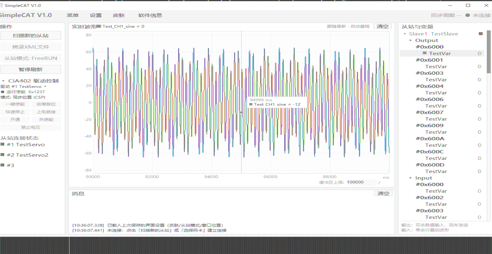

# SimpleCAT — 轻量级 EtherCAT 主站上位机

基于 **SOEM** 的 Windows EtherCAT 主站，内置 **Win32 + GDI 自绘图形界面**（无 Qt / .NET 依赖，单个 exe 即可运行）。

提供从总线扫描、TwinCAT 风格过程映像视图、实时波形监视、输出变量写入、CiA402 驱动控制，到 ESI(XML) → EEPROM(SII) 烧录的完整调试链路，适合中小型 EtherCAT 网络（IO 模块、伺服驱动器）的联调与现场排障。



---

## 功能特性

### 总线与主站
- **扫描从站**：选择网卡后一键扫描，显示每个从站的名称、厂商 ID / 产品代码 / 修订版本、配置地址、AL 状态（TwinCAT 风格标签，如 `SAFE-OP+ERR`）、AL 错误码、DL 端口链路状态
- **状态监视与自动恢复**：周期监视从站状态，从站断电重上电后自动恢复站地址 / SM / FMMU / 回 OP；长时间失联自动触发**完整重扫**（重新枚举 → 重新映射 → 回 OP）
- **DC / FreeRUN**：支持分布式时钟同步（`ecx_dcsync0`）与 FreeRUN 模式一键切换，实时显示同步周期与主循环抖动（min/max）
- **通信质量**：WKC（工作计数器）、期望值、往返时间（μs）实时显示

### 过程映像与变量（TwinCAT 风格扫描）
- 显示每个从站的全部 **RxPDO / TxPDO** 及内部变量（CoE 索引、名称、数据类型、位宽、IOmap 位偏移）
- 变量名优先从 `xml/` 目录的 **ESI 设备描述文件**按厂商 ID + 产品代码匹配；匹配不到时回退为通过 CoE SDO（0x1C12/0x1C13 及 PDO 映射对象）读取实际映射
- **输出变量**：双击数值框就地编辑并下发（下个周期生效）
- **输入变量**：实时刷新显示

### 实时波形（VOFA+ 风格）
- 右键变量树中的输入/输出变量即可叠加到波形，最多 **8 通道**同时显示，自动配色
- 采样周期 1 / 5 / 10 / 50 / 100 / 200 / 500 ms 可选；每通道缓冲上限 1 000 ~ 1 000 000 点可调
- 滚轮缩放时间轴、Ctrl+滚轮缩放 Y 轴、拖动平移、双击恢复"跟随最新 + 自动量程"
- 鼠标游标悬停显示该时刻各通道数值

### CiA402 驱动控制（IEC 61800-5-2）
- 自动检测过程数据中的驱动对象（0x6040/0x6041），解码状态机状态（未就绪 / 未使能 / 上电就绪 / 已开通 / 运行使能 / 故障……）与运行模式（CSP / CSV / PP / VL / HM …）
- 内置操作按钮：**一键使能**（0x06→0x07→0x0F 序列）、故障复位、快速停止、上电就绪、开通、关使能、禁止电压

### ESI → EEPROM 烧录（对标 TwinCAT "Write EEPROM"）
- 列出 `xml/` 目录下可解析的 ESI XML，选择目标从站一键烧录
- 界面显示**绿色进度条**（写 + 校验步数），逐字写入、逐字读回校验
- 身份校验：XML 的厂商 ID / 产品代码与在线从站不符时弹窗确认（换装新 ESI 场景可强制烧录）
- **安全策略**：只重写身份区（字 0x0008–0x000D）和类别区（字 0x0040 起），**不碰 PDI 配置 + CRC 校验区（字 0x0000–0x0007）和序列号**，写错 CRC 会导致 ESC 无法启动，本工具从根源上避开了这一风险

### 界面体验
- 三套皮肤（浅色 / 深色 / 蓝灰）、中英文界面切换
- 消息栏：带毫秒时间戳，支持**鼠标拖选（字符级）+ Ctrl+C 复制**、Ctrl+A 全选、Esc 取消；表头显示 `ERR: N` 错误计数
- **暂停刷新**：冻结数值 / 波形 / 日志便于观察，主站后台通信不中断
- 配置持久化到 `SimpleCAT.ini`（皮肤、语言、采样周期、缓冲上限、窗口位置大小、上次网卡、DC/FreeRUN 偏好等）

---

## 界面导览

```
┌──────────────────────────────────────────────────────────────┐
│ SimpleCAT V1.0    菜单  设置  皮肤  软件信息            [状态] │  ← 顶栏
│ ┌──────┐ ┌──────────────────────────────┐ ┌───────────────┐ │
│ │ 操作 │ │                              │ │ 从站与变量    │ │
│ │扫描  │ │        实时波形区            │ │  Slave1       │ │
│ │烧录  │ │ （多变量叠加，滚轮缩放，   │ │   Output:     │ │
│ │模式  │ │  拖动平移，双击恢复）       │ │    TestVar  0 │ │
│ │暂停  │ │                              │ │   Input:      │ │
│ │────  │ ├──────────────────────────────┤ │    TestVar 11 │ │
│ │CiA402│ │ 消息        ERR: 0   [清空]  │ │  （右键操作） │ │
│ │驱动  │ │ [18:40:12.001] 已进入OP ...  │ │               │ │
│ │状态  │ └──────────────────────────────┘ └───────────────┘ │
│ └──────┘                                                    │
└──────────────────────────────────────────────────────────────┘
```

- **顶栏**
  - `菜单`：选择网卡… / 烧录 XML 到 EEPROM… / 打开 xml 目录 / 退出
  - `设置`：DC 模式 ↔ FreeRUN、波形采样周期、界面语言（中文 / English）
  - `皮肤`：浅色 / 深色 / 蓝灰
- **左侧"操作"**：扫描新的从站 → 烧录 XML 文件 → 从站模式切换 → 暂停刷新；下方为 CiA402 驱动控制与从站连接状态（烧录时这里显示绿色进度条）
- **右侧"从站与变量"**：树状过程映像。输出变量**双击**数值就地编辑下发；输入/输出变量**右键**添加 / 移除波形
- **底部"消息"**：运行日志与错误提示；`ERR: N` 为累计错误条数，点"清空"连同消息一起归零

---

## 目录结构

```
SimpleCAT/
├─ SimpleCAT-V1-UI.slnx     # VS2022 解决方案
├─ soem.vcxproj              # 主工程（产物：SimpleCAT.exe）
├─ src/                      # 主站核心与入口
│  ├─ simple_ng.c            # main()：入口分发（默认图形界面，--console 控制台版）
│  ├─ master_core.c          # 主站生命周期 / 状态监视自动恢复 / 变量读写 / 网卡枚举
│  ├─ tc3_scan.c             # TwinCAT 风格总线扫描 + ESI 解析（PDO/变量/IOmap 偏移）
│  ├─ esi_flash.c            # ESI XML → SII EEPROM 烧录（身份校验 / 进度回调）
│  ├─ main.c                 # slaveinfo 诊断工具（main() 已注释停用）
│  └─ ec_*.c                 # SOEM 协议栈源码（base/coe/dc/foe/eoe/soe/print）
├─ inc/                      # 对应头文件 + WinPcap 头 + ui_lang.h（TR 双语宏）
├─ ui/                       # 图形界面
│  ├─ ui_app.c               # Win32+GDI 自绘 UI（窗口过程 / 绘制 / 交互）
│  ├─ ui_master.c            # 主站后台线程（1ms 周期交换、快照/命令队列）
│  └─ ui_config.c            # SimpleCAT.ini 配置持久化
├─ lib/                      # 预编译库：soem.lib / wpcap.lib / Packet.lib（x64）
├─ xml/                      # 运行时 ESI 目录（程序按相对路径 "xml" 查找）
├─ xml_file/                 # 示例 ESI（OLIF 水箱、YS-IO、6MC 等），用时拷入 xml/
└─ AGENTS.md                 # AI 编码助手的项目说明（对程序功能无影响）
```

---

## 环境要求

| 项目 | 要求 |
|------|------|
| 操作系统 | Windows 10 / 11（**x64**） |
| 编译器 | Visual Studio 2022（C++ 桌面开发，工具集 v145；低版本可在项目属性中改为 v143） |
| 抓包驱动 | **Npcap**（安装时勾选 *WinPcap API-compatible Mode*）或 WinPcap |
| 运行权限 | **管理员身份**运行（需要 raw socket 收发原始以太网帧） |
| 硬件 | 有线以太网网卡（直连 EtherCAT 从站或经交换机；不要选 WiFi / 虚拟网卡） |

> 注意：仓库内 `lib/` 只提供 **x64** 预编译库；Win32 配置未配置链接库，请统一使用 **Debug | x64** 或 **Release | x64**。

---

## 编译

1. 克隆仓库：
   ```bat
   git clone https://github.com/NutHero/SimpleCAT-EtherCAT-MasterV1.0.0.git
   cd SimpleCAT-EtherCAT-MasterV1.0.0
   ```
2. 用 **Visual Studio 2022** 打开 `SimpleCAT-V1-UI.slnx`；
3. 配置选择 **Debug | x64**（或 Release | x64）；
4. 生成解决方案，产物为 `x64\Debug\SimpleCAT.exe`。

命令行编译（可选）：
```bat
msbuild soem.vcxproj /p:Configuration=Debug /p:Platform=x64
```
> 命令行编译若报 `MSB6001`，检查系统环境变量是否同时存在大小写重复的代理变量（如 `HTTPS_PROXY` 与 `https_proxy`），删掉重复项即可。

---

## 运行

| 方式 | 说明 |
|------|------|
| 直接双击 `SimpleCAT.exe` | 进入图形界面（默认） |
| `SimpleCAT.exe --ui` | 同上 |
| `SimpleCAT.exe --console` | 控制台版：自动枚举网卡并选择 |
| `SimpleCAT.exe \Device\NPF_{GUID}` | 控制台版：使用指定网卡 |

**重要**：程序按相对路径 `xml/` 查找 ESI 设备描述文件，请保证 `xml` 目录与 exe 同目录（或从 exe 所在目录启动）。

### 图形界面快速上手

1. **以管理员身份运行** → 顶栏 `菜单` → `选择网卡...` → 选中连接从站的有线网卡；
2. 左侧 `扫描新的从站`：程序完成初始化 → 扫描 → PDO 映射 → 切 OP，右侧出现从站与变量树；
3. 右键输入变量 → 添加波形；双击输出变量数值 → 就地编辑下发；
4. 伺服驱动器会在左侧出现 `CiA402 驱动控制` 面板，可一键使能 / 故障复位；
5. 烧录 ESI：左侧 `烧录XML文件` → 选择目标从站与 xml 文件 → 观察绿色进度条 → **完成后给该从站重新上电**。

---

## xml / ESI 说明

- `xml/` 是运行时目录：变量名匹配、身份匹配警告、EEPROM 烧录都从这里取 ESI；
- ESI 文件需包含可解析的 `<Device>` 节点（厂商 ID、产品代码、SyncManager、PDO）；
- `xml_file/` 内是几个示例 ESI（`OLIF-WaterTank.xml`、`YS-IO.xml`、`6MC_RW.xml` 等），使用时拷贝到 `xml/`；
- 在线从站身份与 xml 不一致时：扫描阶段仅提示警告；**烧录**阶段会弹确认框，确认后按 TwinCAT 的规则把新身份写入 EEPROM。

---

## 配置文件 SimpleCAT.ini

位于 exe 同目录，绿色便携，可直接查看 / 删除：

| 配置项 | 说明 |
|--------|------|
| 皮肤 / 语言 | 浅色 / 深色 / 蓝灰；中文 / English |
| 从站模式 | DC / FreeRUN（未设置时按从站能力自动） |
| 波形采样周期 | 1 ~ 500 ms |
| 波形缓冲上限 | 每通道 1000 ~ 1 000 000 点 |
| 窗口 | 位置、大小、是否最大化 |
| 上次网卡 | 仅用于菜单标记，**不自动连接** |
| 上次烧录从站 | 烧录弹窗默认选中 |

---

## 注意事项与已知限制

1. **EEPROM 烧录有风险**：虽然本工具不写 CRC / PDI 区（不会烧砖），但烧错从站仍会改写其身份与类别区。烧录前务必确认目标从站序号；烧录完成后**必须给从站重新上电**，ESC 才会从 EEPROM 重新加载配置。
2. **EEPROM 访问权**：从站进入 OP 后 EEPROM 通常归 PDI（从站 MCU）持有，主站读写会全部 NACK（表现为"读回全 0"）。程序烧录前会自动把从站切 INIT 并收回访问权；若从站固件强行占用，需先复位从站。
3. **IOmap 上限 4096 字节**：全部从站 PDO 映射总和超过 4096 字节会映射失败。
4. **实时性**：1 ms 周期运行在普通用户线程（`timeBeginPeriod` 提高定时精度）上，Windows 非实时系统，周期抖动（min/max）正常会有波动；对抖动敏感的应用请在干净环境下运行并关闭无关后台程序。
5. **暂停刷新只是冻结界面**：数值 / 波形 / 日志停止刷新，但主站后台线程的 1 ms 周期通信与自动恢复仍在运行。
6. **仅支持 x64**：Win32 配置未链接 wpcap / Packet 库，编译会失败。
7. **管理员权限**：未以管理员运行时将无法打开网卡，提示启动失败。
8. **从站进不了 OP**：常见原因是 PDO 映射 / 身份与 ESI 不匹配。图形界面会显示 ESI 不匹配摘要，可先"烧录 XML 文件"写入匹配的 ESI 后重新上电再扫（控制台版启动失败会进入恢复模式，支持 `flash / scan / retry / quit` 命令）。
9. **变量名显示为 TestVar / 未知**：`xml/` 目录缺少该从站对应的 ESI，按厂商 ID + 产品代码补齐即可。

---

## 常见问题（FAQ）

**Q：启动失败 / 找不到网卡？**
A：确认已安装 Npcap（勾选 WinPcap 兼容模式）、以管理员运行、选择的是有线物理网卡。

**Q：烧录时读回全 0？**
A：EEPROM 访问权还在 PDI 手里。程序会自动处理（切 INIT + 收回访问权）；若仍失败，给从站断电重启后再试。

**Q：烧录完成后从站行为没变？**
A：ESC 只在上电复位时加载 EEPROM，请给从站重新上电，再重新扫描。

**Q：双击输出变量无法编辑？**
A：只有输出（RxPDO）变量可写；输入变量只读。且总线需处于 OP 状态。

**Q：波形很卡 / 内存占用高？**
A：调小"波形缓冲区上限"或加大采样周期（`设置` 菜单）。

---

## 致谢

- [SOEM（Simple Open EtherCAT Master）](https://github.com/OpenEtherCATs/SOEM) —— EtherCAT 主站协议栈
- [Npcap](https://npcap.com/) —— Windows 抓包驱动
- 界面与交互参考了 **TwinCAT 3**（Scan Boxes / Process Image / Write EEPROM）与 **VOFA+**（波形交互）的使用习惯

## 许可

本项目包含 / 链接 SOEM 派生代码，分发时请遵循 SOEM 的许可证（GPLv2 + linking exception，详见其源码头注释）以及 `lib/` 内预编译库的相应条款。业务代码的许可待定，使用前请与作者确认。

<!-- LICENSE.md 目前未随仓库分发 -->
